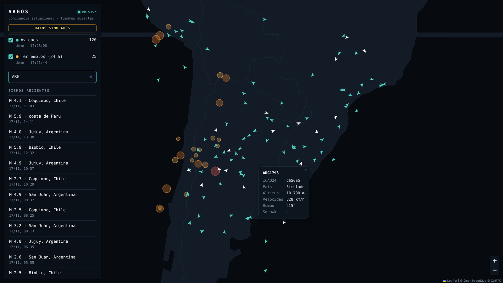

# ARGOS

Mapa global en tiempo real construido solo con fuentes abiertas: aviones (ADS-B vía OpenSky)
y terremotos (USGS). Backend en Python y frontend en TypeScript, separados y comunicados por
REST y WebSocket.

Ningún dato personal: solo señales y registros públicos.



## Arquitectura

```
fuentes ──► recolectores ──► caché ──► WebSocket ──► navegador
                   │                    ▲
                   └──► historial ──────┘ REST
```

### Backend (`backend/`, FastAPI)

| Carpeta | Responsabilidad |
|---|---|
| `app/collectors/` | Un módulo por fuente. Todos implementan `Collector.fetch()` y devuelven `Entity`. No conocen la API ni la base. |
| `app/domain/` | Modelo común (`Entity`, `LayerStatus`, `Snapshot`). Es el contrato con el frontend. |
| `app/services/` | Planificador (un ciclo por fuente, con espera creciente ante errores), caché en memoria y difusión por WebSocket. |
| `app/storage/` | Historial en SQLite detrás de una interfaz chica, para poder pasar a Postgres/PostGIS. |
| `app/api/` | REST (`/api/...`) y WebSocket (`/ws`). Solo leen de la caché y del historial: nunca consultan fuentes. |
| `app/core/` | Configuración por variables de entorno y logs. |

Si una fuente se cae, su capa conserva el último dato bueno y muestra el error; las demás siguen funcionando.

### Frontend (`frontend/`, Vite + TypeScript + Leaflet)

| Carpeta | Responsabilidad |
|---|---|
| `src/api/` | Tipos del contrato y cliente REST/WebSocket con reconexión automática. |
| `src/state/` | Estado global inmutable con suscripción. |
| `src/map/` | Mapa base, sin lógica de datos. |
| `src/layers/` | Una clase por capa con la interfaz `MapLayer`; se registran en `registry.ts`. |
| `src/ui/` | Panel: conexión, capas, buscador y sismos recientes. |

## Endpoints

| Método | Ruta | Devuelve |
|---|---|---|
| GET | `/api/health` | estado y modo (`live` o `demo`) |
| GET | `/api/layers` | estado de cada capa |
| GET | `/api/layers/{capa}` | entidades actuales de una capa |
| GET | `/api/history/{capa}?hours=24` | observaciones guardadas |
| WS | `/ws` | estado completo al conectar y cada actualización después |

La documentación interactiva queda en `http://localhost:8000/docs`.

## Cómo correrlo

### Con Docker

```bash
cp .env.example .env
docker compose up --build
# http://localhost:8080
```

### En desarrollo

```bash
# backend
cd backend
python -m venv .venv && source .venv/bin/activate
pip install -e ".[dev]"
ARGOS_MODE=demo uvicorn app.main:app --reload     # o sin ARGOS_MODE para datos reales

# frontend (otra terminal)
cd frontend
npm install
npm run dev                                       # http://localhost:5173
# Mapa base: copiá .env.example a .env y elegí osm-dark, osm o esri-dark
```

## Tests

```bash
cd backend && pytest
```

Los tests no usan red: las respuestas de las fuentes se simulan.

## Cómo agregar una fuente

1. Backend: crear `app/collectors/<fuente>.py` con una subclase de `Collector` y sumarla en `registry.py`.
2. Frontend: crear `src/layers/<capa>Layer.ts` implementando `MapLayer` y sumarla en `registry.ts`.

## Próximos pasos

- Satélites y Estación Espacial (CelesTrak)
- Barcos (AISStream, requiere clave gratuita)
- Eventos naturales (NASA EONET)
- Alertas: sismos fuertes, códigos de emergencia 7500/7600/7700
- Línea de tiempo sobre el historial
- Integrar el auditor de dominios como un módulo más
