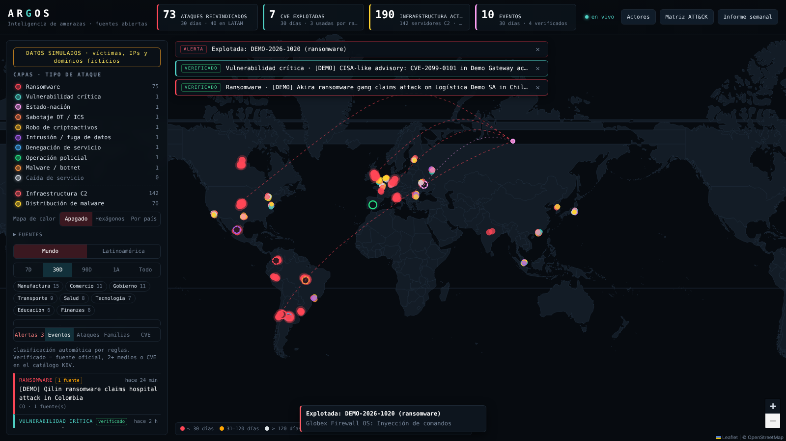
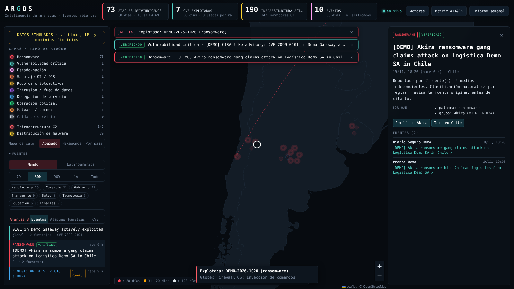
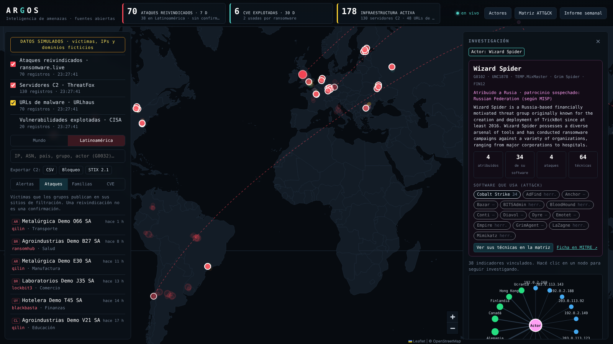
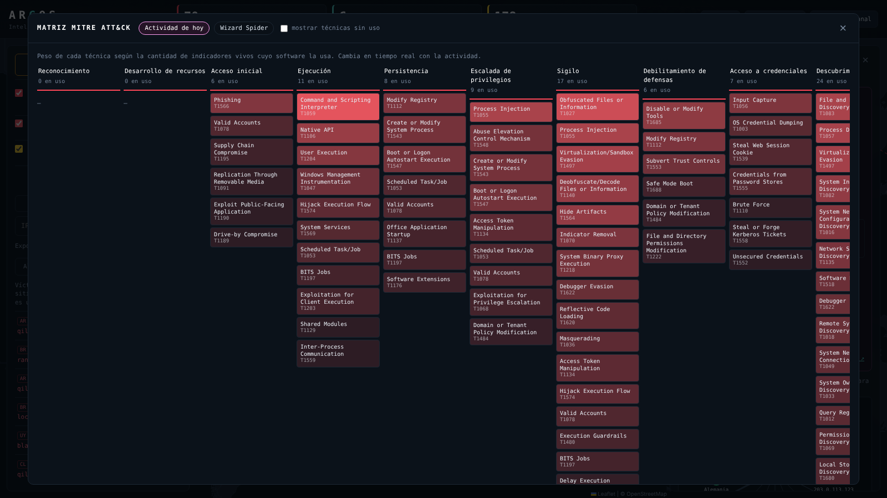

# ARGOS

Plataforma de inteligencia de amenazas con fuentes abiertas que une las dos capas que normalmente
se ven por separado:

- **Qué pasó:** víctimas de ransomware, vulnerabilidades explotadas y los actores detrás, con su
  perfil y sus técnicas de MITRE ATT&CK.
- **Qué está activo ahora:** los servidores de comando y control y las URLs de malware, en vivo.

Así una noticia ("el grupo X atacó a Y") se convierte en una acción defensiva: qué técnicas usa,
qué infraestructura tiene activa hoy y qué bloquear.


## Qué hace

**Capas por tipo de ataque.** Ransomware, vulnerabilidad crítica, estado-nación, sabotaje OT/ICS, robo de
criptoactivos, intrusión o fuga de datos, DDoS, operación policial, malware y caída de servicio, más la
infraestructura C2 y la distribución de malware. Cada tipo tiene su contador y su interruptor, y un
**mapa de calor** propio (hexágonos o burbujas por país, escala logarítmica) muestra dónde se concentra todo.



**Eventos de avisos y noticias, verificados y sin IA.** Cada 30 minutos ARGOS lee los avisos de CISA,
CERT-EU e INCIBE-CERT y la prensa especializada (BleepingComputer, The Record, SecurityWeek, Help Net
Security, The Hacker News, Krebs on Security). Con reglas, no con un modelo de lenguaje:

1. **Extrae** CVE, grupos y malware (contra el diccionario de MITRE ATT&CK), países afectados y origen
   atribuido, y el tipo de ataque por palabras clave en castellano e inglés.
2. **Agrupa** las notas que cuentan el mismo hecho (mismo CVE, mismo actor o título casi igual).
3. **Verifica:** un evento es *verificado* si lo publica una fuente oficial, si lo cuentan 2 o más medios
   o si su CVE está en el catálogo KEV. Además consulta el registro público de CVE y avisa cuando un CVE
   citado no tiene registro publicado.
4. **Explica:** cada ficha dice *por qué* se clasificó así ("palabra: ransomware · grupo: Akira").

De cada nota se guarda solo el título, el enlace, la fecha y el medio: el contenido sigue siendo de quien
lo publicó.



**Tres contadores de base, separados.** Mezclar avisos con ataques infla las cifras y ubicar
un boletín en la ciudad de quien lo emite distorsiona el mapa. ARGOS no hace ninguna de las dos cosas:

| Contador | Fuente | Ubicación en el mapa |
|---|---|---|
| Ataques reivindicados | [ransomware.live](https://www.ransomware.live), con [RansomLook](https://www.ransomlook.io) de respaldo | País de la víctima (RansomLook no lo informa: esos se listan sin ubicar) |
| Vulnerabilidades explotadas | [CISA KEV](https://www.cisa.gov/known-exploited-vulnerabilities-catalog) | Ninguna: no tienen ubicación, y no se les inventa |
| Infraestructura activa | [ThreatFox](https://threatfox.abuse.ch) y [URLhaus](https://urlhaus.abuse.ch) | Geolocalización de la IP |

Las víctimas de ransomware se muestran siempre como **reivindicadas**: las publican los propios grupos
para presionar el pago, y a veces mienten.

**Actores y MITRE ATT&CK conectados a datos vivos.** Cada indicador se enlaza con la base de
conocimiento de ATT&CK (178 grupos, 842 programas, 706 técnicas): un servidor de Cobalt Strike queda
vinculado a los grupos que usan Cobalt Strike, y un ataque reivindicado por Akira, al grupo Akira y a
sus técnicas.

- **Ficha de cada actor:** alias, país atribuido según MISP (o "sin atribución", nunca inventado),
  software que usa con su actividad de hoy, y todo lo vinculado en un grafo navegable.
- **Ranking ponderado por exclusividad:** una herramienta que comparten decenas de grupos, como
  Cobalt Strike, suma poco a cada uno; una familia exclusiva suma completo. Así lo compartido no
  infla el ranking.
- **Arcos de origen** desde el país atribuido hasta la víctima, solo cuando la atribución existe.



**Matriz ATT&CK dinámica.** No muestra lo que un grupo usa "en general", sino el peso de cada técnica
en los indicadores **vivos de hoy**. También se puede ver la matriz de un actor puntual.



**Exploración en el tiempo.** Ventanas de 7, 30 y 90 días, un año o todo el historial; filtro por
sector; colores según antigüedad (hasta 30 días, 31 a 120, más viejo); una franja con lo más importante
de los últimos días, y una ficha completa por ataque que nunca presenta la reivindicación como hecho.

**Investigación por correlación.** Desde una IP, red, país, host, familia o actor se abre un grafo
con todo lo conectado, y cada nodo es un nuevo punto de partida.

**Foco en Latinoamérica.** Vista regional, alertas cuando aparece una víctima o un C2 en un país
vigilado, y una sección propia en el informe semanal.

**Alertas automáticas:** familia de malware nueva, C2, víctima o evento en un país vigilado,
crecimiento brusco de una familia, vulnerabilidades explotadas nuevas y explotación confirmada en las noticias.

**Informe semanal** en Markdown, listo para publicar: familias y grupos más activos, Latinoamérica,
técnicas ATT&CK de la semana, eventos verificados y alertas.

**Exportación** en CSV, lista de bloqueo y [STIX 2.1](https://oasis-open.github.io/cti-documentation/).

## Arquitectura

Backend en Python (FastAPI) y frontend en TypeScript (Vite + Leaflet), comunicados por REST y
WebSocket. El detalle de cada pieza y las decisiones de diseño están en
[docs/ARCHITECTURE.md](docs/ARCHITECTURE.md).

## Seguridad

El modelo de amenazas completo está en [SECURITY.md](SECURITY.md). En resumen:

- Las claves viven solo en `backend/.env`; el navegador nunca las ve, y gitleaks las busca en CI.
- Todo dato externo se valida al entrar y se muestra como texto, nunca como HTML.
- Los indicadores se muestran desactivados (`1[.]2[.]3[.]4`) y el CSV neutraliza fórmulas de Excel.
- La API es de solo lectura, con límite de consultas por cliente y cabeceras de seguridad.
- El modo demo usa IPs y dominios reservados para documentación: nunca acusa a una IP real.

## Calidad

Cada cambio pasa por [GitHub Actions](.github/workflows/ci.yml): linter con reglas de seguridad
(Ruff con Bandit), tests, chequeo de tipos, auditoría de dependencias de Python y de npm, y
búsqueda de claves filtradas. Dependabot propone actualizaciones de dependencias cada semana.

## Cómo correrlo

Requisitos: Python 3.11 o superior y Node.js 18 o superior.

```bash
# backend
cd backend
python -m venv .venv
.venv/Scripts/activate        # Windows (PowerShell: .venv\Scripts\Activate.ps1)
# source .venv/bin/activate   # Linux o Mac
pip install -e ".[dev]"
cp .env.example .env          # y completá ARGOS_ABUSECH_KEY
python -m uvicorn app.main:app --reload

# frontend (otra terminal)
cd frontend
npm install
npm run dev                   # http://localhost:5173
```

Para probarlo sin clave ni red, poné `ARGOS_MODE=demo` en `backend/.env`.

**La clave de abuse.ch es obligatoria para ver infraestructura:** abuse.ch dio de baja las descargas
sin clave de ThreatFox y URLhaus. Sin ella, ARGOS muestra ataques y vulnerabilidades, pero no servidores
C2 ni URLs de malware, y el panel lo avisa.

La clave de abuse.ch (sirve para ThreatFox y URLhaus) es gratuita: se genera en <https://auth.abuse.ch> entrando con una cuenta de
GitHub, Google o similar.

### Con Docker

```bash
cp backend/.env.example backend/.env    # y completá la clave
docker compose up --build               # http://localhost:8080
```

## Endpoints

| Método | Ruta | Devuelve |
|---|---|---|
| GET | `/api/health` | estado y modo (`live` o `demo`) |
| GET | `/api/layers` | estado de cada fuente |
| GET | `/api/layers/{capa}` | entidades actuales (`c2`, `urls`, `kev`, `incidents` o `events`) |
| GET | `/api/pivot?kind=ip&value=…` | correlación de una IP, `asn`, `country`, `malware`, `host` o `actor` |
| GET | `/api/actors` · `/api/actors/{G0032}` | actores con su actividad; perfil completo de uno |
| GET | `/api/attack/matrix?scope=active` | matriz ATT&CK de hoy (o `actor:G0032`, `software:S0154`) |
| GET | `/api/report/weekly.md` | informe semanal en Markdown |
| GET | `/api/alerts` | alertas recientes |
| GET | `/api/export/c2.csv` · `blocklist.txt` · `stix.json` | indicadores exportados (filtros `malware` y `country`) |
| GET | `/api/history/{capa}?hours=24` | observaciones guardadas (por defecto, un año) |
| WS | `/ws` | estado completo y alertas al conectar; cada cambio después |

Documentación interactiva en `http://localhost:8000/docs`.

## Tests

```bash
cd backend
pytest          # tests (sin red: las fuentes se simulan)
ruff check .    # linter con reglas de seguridad
pip-audit .     # vulnerabilidades en dependencias
```

## Base de conocimiento

`backend/app/knowledge/data/` guarda un índice compacto de MITRE ATT&CK y de los actores de MISP
Galaxy, generado con `python -m app.knowledge.build`. Va versionado en el repo para que ARGOS
funcione sin red, y un [workflow mensual](.github/workflows/knowledge.yml) lo regenera y propone
la actualización en un pull request.

## Atribuciones

- MITRE ATT&CK® © The MITRE Corporation. Se usa bajo sus [términos de uso](https://attack.mitre.org/resources/legal-and-branding/terms-of-use/).
- MISP Galaxy, bajo licencia CC0 1.0.
- Indicadores de ThreatFox y URLhaus (abuse.ch), catálogo KEV de CISA y datos de ransomware.live.
- Títulos y enlaces de avisos de CISA, CERT-EU e INCIBE-CERT y de los medios citados en cada evento.

## Próximos pasos

- Sensores propios (honeypots) para producir inteligencia de primera mano
- Cacería de infraestructura por huellas de TLS y HTTP, y agrupación automática en campañas
- Priorización de vulnerabilidades: KEV + EPSS + grupos de ransomware que las usan + sectores afectados
- Servidor TAXII 2.1 y reglas de detección (Suricata y Sigma) generadas desde los indicadores
- Archivo histórico curado de incidentes de Latinoamérica, con fuentes
- Caídas de internet por país, separadas de los ataques
- Instancia pública desplegada con infraestructura como código
