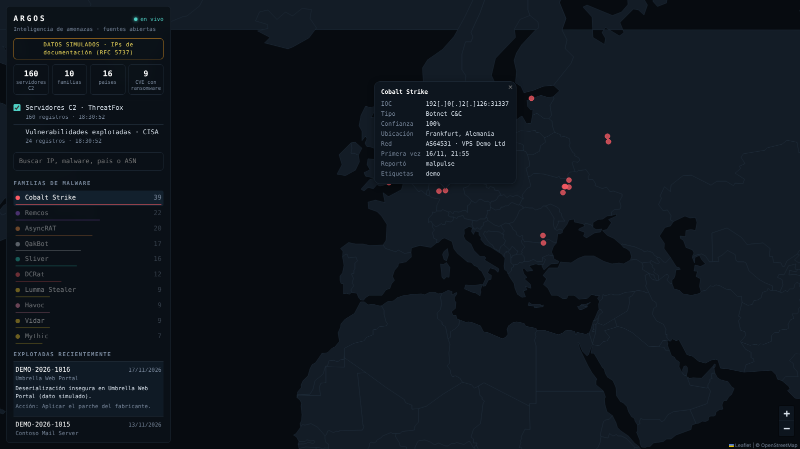

# ARGOS

Plataforma de inteligencia de amenazas con fuentes abiertas. Ubica en un mapa mundial, en tiempo
real, los servidores de comando y control (C2) que usan las familias de malware activas, y sigue
las vulnerabilidades que se están explotando en ataques reales.


## Qué muestra

| Capa | Fuente | Qué es |
|---|---|---|
| Servidores C2 | [ThreatFox](https://threatfox.abuse.ch) (abuse.ch) | IPs y puertos desde los que se controla malware (Cobalt Strike, AsyncRAT, Remcos, etc.), geolocalizados y coloreados por familia |
| Vulnerabilidades explotadas | [CISA KEV](https://www.cisa.gov/known-exploited-vulnerabilities-catalog) | CVE que CISA confirma como explotados, marcando los usados en campañas de ransomware |

En el panel se puede filtrar por familia de malware, buscar por IP, país o ASN, y abrir el detalle
de cada indicador. Las IPs se muestran desactivadas (`45[.]9[.]148[.]10`), como es costumbre al
compartir indicadores, para que no se abran por error.



## Arquitectura

```
fuentes ──► recolectores ──► enriquecimiento (GeoIP + caché) ──► caché ──► WebSocket ──► navegador
                                                                   │                       ▲
                                                                   └──► historial ─────────┘ REST
```

### Backend (`backend/`, Python + FastAPI)

| Carpeta | Responsabilidad |
|---|---|
| `app/collectors/` | Un módulo por fuente (ThreatFox, CISA KEV, demo). Todos implementan `Collector.fetch()` y devuelven `Entity`. |
| `app/geolocation/` | Puerto `Geolocator` con adaptadores intercambiables (ip-api, demo). |
| `app/services/` | Planificador por fuente con espera creciente ante errores, enriquecimiento, caché en memoria y difusión por WebSocket. |
| `app/storage/` | Historial y caché de geolocalización en SQLite, detrás de interfaces chicas. |
| `app/api/` | REST y WebSocket. Solo leen datos ya procesados: nunca consultan fuentes. |
| `app/domain/` | Modelo común (`Entity`, `GeoInfo`, `Snapshot`): el contrato con el frontend. |
| `app/core/` | Configuración por variables de entorno o `backend/.env`. |

### Frontend (`frontend/`, Vite + TypeScript + Leaflet)

| Carpeta | Responsabilidad |
|---|---|
| `src/api/` | Tipos del contrato y cliente REST/WebSocket con reconexión automática. |
| `src/state/` | Estado global inmutable con suscripción (flujo de datos en una sola dirección). |
| `src/layers/` | Una clase por capa del mapa con la interfaz `MapLayer`, registradas en `registry.ts`. |
| `src/map/` | Mapa base configurable, sin lógica de datos. |
| `src/ui/` | Panel: estadísticas, fuentes, familias de malware y vulnerabilidades. |

## Decisiones de seguridad

- **Las claves viven solo en el backend** (`backend/.env`, fuera de Git). El navegador nunca las ve.
- **Todo dato externo se trata como no confiable:** se valida con Pydantic al entrar y se muestra con
  `textContent`, nunca como HTML. Los enlaces solo se aceptan si son `http(s)`.
- **Indicadores desactivados** en la interfaz para evitar clics accidentales.
- **API de solo lectura** (CORS limitado a `GET` y al origen del frontend).
- **El modo demo no acusa a nadie:** usa IPs reservadas para documentación (RFC 5737) y CVE ficticios.
- **Geolocalización mínima:** solo se envían a ip-api IPs públicas que ya son indicadores públicos, y
  cada una se consulta una única vez gracias a la caché.

## Cómo correrlo

Requisitos: Python 3.11 o superior y Node.js 18 o superior.

```bash
# backend
cd backend
python -m venv .venv
.venv/Scripts/activate        # Windows (PowerShell: .venv\Scripts\Activate.ps1)
# source .venv/bin/activate   # Linux o Mac
pip install -e ".[dev]"
cp .env.example .env          # y completá ARGOS_THREATFOX_KEY
python -m uvicorn app.main:app --reload

# frontend (otra terminal)
cd frontend
npm install
npm run dev                   # http://localhost:5173
```

Para probarlo sin clave ni red, poné `ARGOS_MODE=demo` en `backend/.env`.

La clave de ThreatFox es gratuita: se genera en <https://auth.abuse.ch> entrando con una cuenta de
GitHub, Google o similar.

### Con Docker

```bash
cp backend/.env.example .env
docker compose up --build     # http://localhost:8080
```

## Endpoints

| Método | Ruta | Devuelve |
|---|---|---|
| GET | `/api/health` | estado y modo (`live` o `demo`) |
| GET | `/api/layers` | estado de cada fuente |
| GET | `/api/layers/{capa}` | entidades actuales (`c2` o `kev`) |
| GET | `/api/history/{capa}?hours=24` | observaciones guardadas (hasta 90 días) |
| WS | `/ws` | estado completo al conectar y cada actualización después |

Documentación interactiva en `http://localhost:8000/docs`.

## Tests

```bash
cd backend && pytest
```

No usan red: las respuestas de ThreatFox, CISA e ip-api se simulan.

## Próximos pasos

- Auditor de exposición de dominios con autorización verificada por DNS, integrado como capa
- Caídas de internet por país (IODA o Cloudflare Radar)
- Alertas cuando aparece una familia nueva o un C2 en un país o ASN elegido
- Exportar indicadores en formato STIX o como lista de bloqueo
