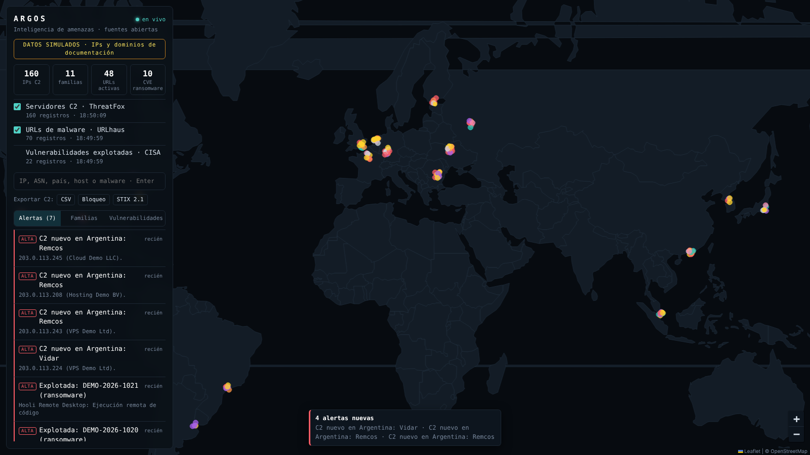
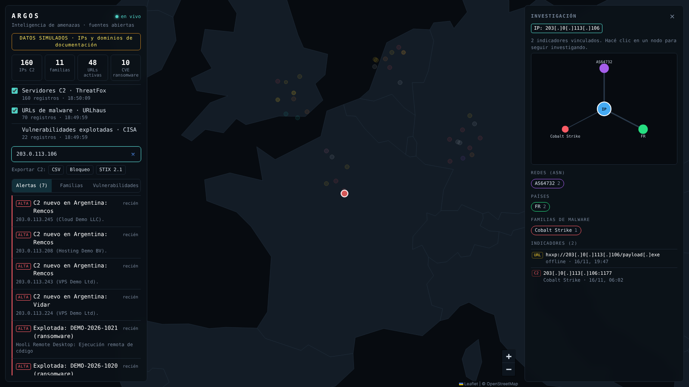

# ARGOS

Plataforma de inteligencia de amenazas con fuentes abiertas. Ubica en un mapa mundial, en tiempo
real, la infraestructura de los atacantes (servidores de comando y control y URLs que distribuyen
malware), la correlaciona para descubrir conexiones, genera alertas y exporta los indicadores en
formatos estándar.



## Qué hace

**Fuentes en vivo**

| Capa | Fuente | Qué es |
|---|---|---|
| Servidores C2 | [ThreatFox](https://threatfox.abuse.ch) | IPs desde las que se controla malware (Cobalt Strike, AsyncRAT, Remcos…), geolocalizadas y coloreadas por familia |
| URLs de malware | [URLhaus](https://urlhaus.abuse.ch) | Enlaces que distribuyen malware; los alojados en una IP aparecen en el mapa |
| Vulnerabilidades explotadas | [CISA KEV](https://www.cisa.gov/known-exploited-vulnerabilities-catalog) | CVE confirmados en ataques reales, marcando los usados por ransomware |

**Investigación por correlación.** Desde cualquier IP, red (ASN), país, host o familia de malware se
abre una investigación que muestra todo lo conectado en un grafo navegable: qué familias usan esa
IP, qué otras IPs maliciosas hay en la misma red, qué URLs de malware aloja. Cada nodo es un nuevo
punto de partida, y el recorrido queda en migas para volver atrás.



**Alertas automáticas** cuando aparece una familia de malware nunca vista, un servidor C2 en un
país vigilado, un crecimiento brusco de una familia o una vulnerabilidad explotada nueva (con
severidad alta si la usa el ransomware).

**Exportación** de los indicadores en CSV, como lista de bloqueo para un firewall, o en
[STIX 2.1](https://oasis-open.github.io/cti-documentation/), el estándar para compartir
inteligencia de amenazas entre herramientas. Se puede exportar todo o solo una familia o un país.

## Arquitectura

Backend en Python (FastAPI) y frontend en TypeScript (Vite + Leaflet), comunicados por REST y
WebSocket. El detalle de cada pieza y las decisiones de diseño están en
[docs/ARCHITECTURE.md](docs/ARCHITECTURE.md).

## Seguridad

El modelo de amenazas completo está en [SECURITY.md](SECURITY.md). En resumen:

- Las claves viven solo en `backend/.env`; el navegador nunca las ve, y gitleaks las busca en CI.
- Todo dato externo se valida al entrar y se muestra como texto, nunca como HTML.
- Los indicadores se muestran desactivados (`1[.]2[.]3[.]4`) y el CSV neutraliza fórmulas de Excel.
- La API es de solo lectura, con límite de consultas por cliente y cabeceras de seguridad.
- El modo demo usa IPs y dominios reservados para documentación: nunca acusa a una IP real.

## Calidad

Cada cambio pasa por [GitHub Actions](.github/workflows/ci.yml): linter con reglas de seguridad
(Ruff con Bandit), tests, chequeo de tipos, auditoría de dependencias de Python y de npm, y
búsqueda de claves filtradas. Dependabot propone actualizaciones de dependencias cada semana.

## Cómo correrlo

Requisitos: Python 3.11 o superior y Node.js 18 o superior.

```bash
# backend
cd backend
python -m venv .venv
.venv/Scripts/activate        # Windows (PowerShell: .venv\Scripts\Activate.ps1)
# source .venv/bin/activate   # Linux o Mac
pip install -e ".[dev]"
cp .env.example .env          # y completá ARGOS_ABUSECH_KEY
python -m uvicorn app.main:app --reload

# frontend (otra terminal)
cd frontend
npm install
npm run dev                   # http://localhost:5173
```

Para probarlo sin clave ni red, poné `ARGOS_MODE=demo` en `backend/.env`.

La clave de abuse.ch (sirve para ThreatFox y URLhaus) es gratuita: se genera en <https://auth.abuse.ch> entrando con una cuenta de
GitHub, Google o similar.

### Con Docker

```bash
cp backend/.env.example backend/.env    # y completá la clave
docker compose up --build               # http://localhost:8080
```

## Endpoints

| Método | Ruta | Devuelve |
|---|---|---|
| GET | `/api/health` | estado y modo (`live` o `demo`) |
| GET | `/api/layers` | estado de cada fuente |
| GET | `/api/layers/{capa}` | entidades actuales (`c2`, `urls` o `kev`) |
| GET | `/api/pivot?kind=ip&value=…` | correlación de una IP, `asn`, `country`, `malware` o `host` |
| GET | `/api/alerts` | alertas recientes |
| GET | `/api/export/c2.csv` · `blocklist.txt` · `stix.json` | indicadores exportados (filtros `malware` y `country`) |
| GET | `/api/history/{capa}?hours=24` | observaciones guardadas (hasta 90 días) |
| WS | `/ws` | estado completo y alertas al conectar; cada cambio después |

Documentación interactiva en `http://localhost:8000/docs`.

## Tests

```bash
cd backend
pytest          # tests (sin red: las fuentes se simulan)
ruff check .    # linter con reglas de seguridad
pip-audit .     # vulnerabilidades en dependencias
```

## Próximos pasos

- Auditor de exposición de dominios con autorización verificada por DNS, integrado como capa
- Víctimas de ransomware publicadas por los grupos, por país y sector
- Caídas de internet por país (IODA o Cloudflare Radar)
- Línea de tiempo para reproducir la evolución de una campaña sobre el historial
- Enriquecimiento con certificados TLS y DNS pasivo para descubrir infraestructura relacionada
